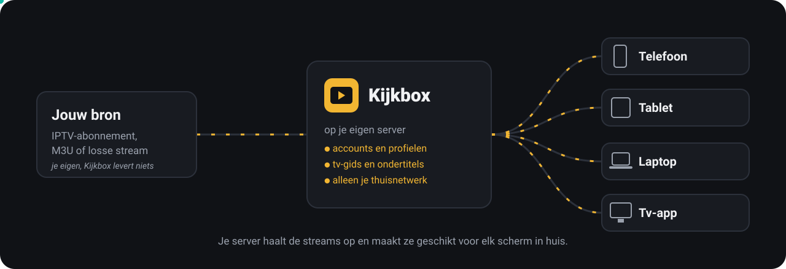

<p align="center"></p>

<p align="center">
  <a href="#installeren-op-proxmox"><b>Installeren</b></a> ·
  <a href="#zo-werkt-het"><b>Zo werkt het</b></a> ·
  <a href="#tv-app-google-tv--android-tv"><b>Tv-app</b></a> ·
  <a href="https://agtenhosting.com/tools/kijkbox/"><b>Website</b></a>
</p>

<p align="center">
  <a href="LICENSE"></a>
  <a href="https://github.com/sagten88/kijkbox/tags"></a>
  <a href="#gemaakt-met-claude"></a>
</p>

# Kijkbox

Je eigen IPTV-website met accounts: live tv met gids, films en series, op telefoon, tablet, laptop en tv.
Kijkbox draait op je eigen server. Iedereen in huis krijgt een eigen account, met eigen favorieten en "verder kijken".

> **Kijkbox levert zelf geen zenders, films of series.** Het is alleen de speler en de omgeving eromheen.
> Je voegt zelf een bron toe die je al hebt, bijvoorbeeld van je IPTV-abonnement. Gebruik alleen bronnen
> waar je recht op hebt. Wat je ermee bekijkt, is je eigen verantwoordelijkheid.

## Installeren op Proxmox

Open de shell van je Proxmox-host (als root) en voer uit:

```bash
bash -c "$(curl -fsSL https://raw.githubusercontent.com/sagten88/kijkbox/main/install.sh)"
```

<p align="center"></p>

Het script:

1. vraagt een paar dingen (containernummer, opslag, geheugen, netwerk), met standaardwaarden;
2. maakt een Debian 13-container en haalt Kijkbox op van GitHub;
3. installeert alleen een versie met een geldige handtekening van de uitgever;
4. installeert Node.js en FFmpeg en stelt automatische updates in;
5. toont het adres en de **installatiecode** voor het eerste account.

Open dat adres, maak met de installatiecode je beheerdersaccount en voeg bij **Instellingen > Bronnen** je bron toe.
Meer over paden, updates en gebruik buiten huis staat bij [Proxmox: details](#proxmox-details).

**Liever Docker?** Download [docker-compose.yml](docker-compose.yml) en start met `docker compose up -d`; zie [Docker](#docker).

## Zo werkt het

<p align="center"></p>

<p align="center">
  
  
</p>
<p align="center"><sub>Illustraties van Kijkbox op een tv en een telefoon.</sub></p>

## Op een Windows-pc (zonder Proxmox)

1. Installeer [Node.js](https://nodejs.org) (versie 24 of nieuwer) en download deze code (**Code > Download ZIP**).
2. Dubbelklik op **Start Kijkbox.bat**.
3. Open `http://localhost:3000` op deze pc.
4. Maak het beheerdersaccount aan. De installatiecode staat in het zwarte venster.
5. Ga naar **Instellingen > Bronnen** en voeg je bron toe.

Laat het zwarte venster open: de site draait zolang dat openstaat.

## Op je telefoon of iPad

Het zwarte venster toont bij **Op je thuisnetwerk** een adres, bijvoorbeeld `http://192.168.1.50:3000`.
Open dat adres op je telefoon of iPad, op dezelfde wifi.

- **Lukt verbinden niet?** Windows Firewall blokkeert de site dan waarschijnlijk. Sta Node.js toe op
  privénetwerken wanneer Windows daarom vraagt. Staat je wifi op "Openbaar", zet die dan op "Privé".
- **Als app op je beginscherm:** kies op iPhone/iPad in Safari **Deel > Zet op beginscherm**,
  op Android in Chrome **Toevoegen aan startscherm**.

## Bronnen

| Type | Wat je nodig hebt |
| --- | --- |
| Xtream | Server-adres, gebruikersnaam en wachtwoord van je provider |
| M3U-link | Link naar een afspeellijst |
| M3U-bestand | Een `.m3u`-bestand, of de inhoud geplakt |
| Losse stream | Een naam en een link naar één stream (`.m3u8`, `.ts`, `.mp4`, enzovoort) |

Bij Xtream is **MPEG-TS** het aanbevolen streamformaat. Dat gebruikt één doorlopende verbinding. HLS-links van
Xtream-providers zijn vaak maar kort geldig, waardoor een stream na een halve minuut kan vastlopen of foutcode 509 krijgt.

Valt een live-verbinding weg, dan start de server hem vanzelf opnieuw. Je ziet dan een kort hapertje.

De tv-gids wordt bij Xtream automatisch opgehaald. Bij M3U gebruikt de site de gids-link uit de afspeellijst,
of de link die je onder **Meer opties** invult. Zenders moeten een `tvg-id` hebben dat in de gids voorkomt.

Bronnen en de tv-gids worden elke nacht om 04:00 vanzelf bijgewerkt (ander uur: zet `REFRESH_HOUR`). Stond de server op dat moment uit, dan gebeurt het zodra hij weer draait. Bij Instellingen → Bronnen zie je wanneer de laatste en de volgende update is. Lukt een update niet, dan probeert hij het elk uur opnieuw.

## Tv-app (Google TV / Android TV)

Er is een app voor **Google TV** en **Android TV** (bijvoorbeeld Philips, Sony, TCL, of een Chromecast met Google TV).
Met de afstandsbediening navigeer je door Live, Gids, Films en Series. Tv's met een eigen systeem, zoals Samsung (Tizen),
LG (webOS) en de meeste Hisense (VIDAA), kunnen de app niet installeren; gebruik daar een Chromecast met Google TV.

Je hebt het adres van je Kijkbox-server nodig, bijvoorbeeld `192.168.1.50:3000`. Je vindt het ook in Kijkbox bij
**Account > Tv koppelen**.

### Tv-app installeren

**Manier 1: zonder computer (met de app Downloader)**

1. Open op de tv de **Google Play Store**, zoek **Downloader** (van AFTVnews) en installeer die.
2. Geef Downloader toestemming om apps te installeren:
   **Instellingen > Apps > Beveiliging en beperkingen > Onbekende bronnen > Downloader** aan.
   (De naam kan per tv iets verschillen; op sommige tv's vraagt Downloader het vanzelf.)
3. Open Downloader en typ het adres van je server met `/tv.apk` erachter, bijvoorbeeld `http://192.168.1.50:3000/tv.apk`.
4. Kies **Installeren**. Open daarna **Kijkbox** en vul het adres van je server in.

**Manier 2: vanaf een Windows-pc**

De installer zet de app via het netwerk op de tv en vult het serveradres meteen in.

1. Op de tv (eenmalig): **Instellingen > Systeem > Over**, klik **7 keer** op **Android TV OS-build** (of *Build*).
   Zet daarna bij **Instellingen > Systeem > Ontwikkelaarsopties** **USB-foutopsporing** aan (op nieuwere tv's
   **Draadloze foutopsporing**; de installer helpt dan met koppelen). Zoek het IP-adres van de tv op bij
   **Instellingen > Netwerk en internet**.
2. Open op de pc **PowerShell** en voer uit:

   ```powershell
   irm https://raw.githubusercontent.com/sagten88/kijkbox/main/install-tv-app.ps1 | iex
   ```

3. Kies op de tv **Altijd toestaan vanaf deze computer** en **Toestaan** als daarom gevraagd wordt.

De app staat ook bij de [releases](https://github.com/sagten88/kijkbox/releases) als download.

### Daarna

- **Koppelen:** de tv toont een code. Vul die op je telefoon in onder **Account > Tv koppelen**. Met de **+** op het
  profielscherm voeg je later meer accounts toe.
- **Serveradres wijzigen:** via **Account > Serveradres van de app wijzigen**, de Menu-toets, of het foutscherm als de
  server niet bereikbaar is.
- **Updates:** veranderingen aan de site komen vanzelf op de tv. Een nieuwe versie van de app zelf is zelden nodig;
  installeer die dan op dezelfde manier opnieuw (je instellingen blijven bewaard).

### Voor ontwikkelaars

`tv-app/` bevat een kleine Android-app die de site schermvullend opent in een tv-weergave voor de afstandsbediening.
De app voegt `KijkboxTV` toe aan de browsernaam; met `?tv` achter het adres zie je dezelfde weergave in een gewone browser.

- **Bouwen:** `powershell -ExecutionPolicy Bypass -File tv-app\build.ps1 -Version 4`. Verhoog het versienummer bij elke nieuwe build.
- **Installeren met ADB:** `adb connect <ip-van-tv>:5555` en daarna `adb install -r tv-app\kijkbox-tv.apk`. Het adres kan
  meteen mee: `adb shell am start -n nl.agtenhosting.kijkbox/.MainActivity --es server <adres>`.
- **Ondertekenen:** de sleutel hoort in `tv-app\signing\`, en staat niet in de repository. Een update moet met dezelfde
  sleutel ondertekend zijn als de geïnstalleerde app. Zelf gebouwd met een eigen sleutel? Verwijder dan eerst de app van
  de tv.

## Filteren op land

Bij Live en in de Gids kies je een land, met Nederland bovenaan. De site haalt het land uit de naam van de groep,
bijvoorbeeld `┃NL┃ Sport`, `[NL] Sport` of `NL | Sport`. Groepen zonder landcode staan onder **Overig**. Je keuze wordt per
apparaat onthouden. Landnamen staan in `server/countries.js`; een onbekende code verschijnt gewoon als die code.

Bij Films en Series kan dat ook. Standaard staan daar alle landen aan; zoeken zet dan Nederlandse versies bovenaan,
Engelstalige daarna en de rest daaronder.

## Weergave

- **Eén kaart per titel:** dezelfde film of serie in meerdere talen staat als één kaart (met "x talen"). Op de pagina
  van de titel kies je de versie; Nederlands is de standaard, daarna Engels. Bij een land- of categoriekeuze zie je
  gewoon alle versies van dat land.
- **Sorteren** bij Films en Series: nieuw toegevoegd, releasejaar, beoordeling of A–Z.
- **Achtergrondbeeld** op de pagina van een film of serie, en een uitgelichte film bovenaan Home (als de provider
  een breed beeld meegeeft).
- **Live als tegels:** knop naast het zoekveld, met wat er nu en straks op is.
- Onder **Account**, per account: kleurthema, weergave (donker, licht of OLED-zwart) en **Verbergen** van landen en
  categorieën die je nooit kijkt. Op de tv ook de tekstgrootte (per tv).

## Profielen op de tv

Bij het opstarten toont de tv-app **Wie kijkt er?** met de accounts die op die tv zijn aangemeld. Met de **+** meld je
er een account bij aan (via de koppelcode). Met **Account afmelden** haal je een account van de tv af (twee keer OK);
het account zelf blijft bestaan. Wie zijn wachtwoord wijzigt, wordt op alle andere tv's afgemeld.

## Ondertitels

Bij films en afleveringen staat in de speler een knop **CC**. Die wisselt tussen uit, **NL** en **EN**; de keuze wordt
per apparaat onthouden. De ondertitels komen van [OpenSubtitles](https://www.opensubtitles.com):

1. Maak daar een gratis account en vraag een API-sleutel aan (bij "API consumers").
2. Vul als beheerder in Kijkbox bij **Instellingen > Ondertitels** de sleutel in, en je gebruikersnaam en wachtwoord van
   OpenSubtitles. Met account mag je meer ondertitels per dag downloaden. Het wachtwoord wordt versleuteld opgeslagen.

Kijkbox zoekt op het TMDB-nummer dat de provider meegeeft, en anders op titel en jaar. Machinevertalingen komen
achteraan. Een gedownloade ondertitel wordt bewaard in `subtitles/` in de datamap, dus opnieuw kijken kost geen download.

## Samen kijken

Kijk met anderen in huis tegelijk hetzelfde, ieder op een eigen telefoon, laptop of tv. Het staat standaard **uit**;
de beheerder zet het aan bij **Instellingen > Server > Samen kijken**.

- **Starten:** kies in de speler de knop met de twee poppetjes (op de tv: **Samen kijken** in de balk; bij live met
  pijltje rechts). Jij bent dan de gastheer en bedient afspelen, pauze, spoelen en een andere zender of aflevering.
- **Meekijken:** anderen zien het op **Home** onder **Samen kijken**, of openen de link (knop **Link** in de speler).
  Meekijkers lopen gelijk met de gastheer, binnen een seconde, ook bij live.
- **Stoppen:** stopt de gastheer (speler dicht, of **Stoppen** bij samen kijken), dan stopt het ook bij de
  meekijkers. Een meekijker kan zelf **Stoppen met meekijken** of de speler sluiten.
- **Verder kijken:** wat je samen kijkt, komt alleen bij de gastheer in **Verder kijken**, niet bij de meekijkers.
- **Eén verbinding:** iedereen kijkt naar dezelfde stream op de server, dus je provider ziet maar één verbinding.
- Het werkt alleen tussen accounts op deze Kijkbox, niet met mensen buiten je huis.

## Accounts

- **Beheerder:** beheert bronnen en accounts.
- **Kijker:** kan alleen kijken. Heeft eigen favorieten en eigen "verder kijken".

Je maakt accounts aan onder **Account > Accounts**. Zelf registreren kan niet. Onder **Account** kiest iedereen ook een
eigen kleurthema; geel is de standaard.

## Goed om te weten

- **Bronnen zijn gedeeld.** Elk account ziet dezelfde zenders en films.
- **Verbindingen:** alle streams lopen via deze pc. Veel providers staan maar 1 of 2 verbindingen tegelijk toe.
  Kijken twee mensen naar verschillende zenders, dan telt dat als twee verbindingen.
- **Omzetten kost rekenkracht.** Streams in HEVC worden door de pc omgezet naar H.264. `MAX_FFMPEG`
  (standaard 4) bepaalt hoeveel streams tegelijk omgezet of herverpakt mogen worden.
- **Omgezette films (`.mkv`, `.avi`):** spoelen kan alleen binnen het deel dat al is verwerkt.
- **Beveiliging thuis:** het adres begint met `http`, dus je wachtwoord gaat onversleuteld over je wifi.
  Gebruik de site zo alleen op je eigen netwerk. Stel hem niet open via port forwarding op je router.
- **Back-up:** de map `data` bevat alles: accounts, bronnen (met provider-wachtwoorden) en favorieten.
  Deel die map niet.

## Proxmox: details

Installeren staat [bovenaan](#installeren-op-proxmox). Kijkbox werkt daarna eerst **alleen op je thuisnetwerk**
(zie hieronder).

| Wat | Waar |
| --- | --- |
| Website | `/opt/kijkbox` |
| Broncode (git, voor updates) | `/opt/kijkbox-src` |
| Gegevens (accounts, bronnen, favorieten) | `/var/lib/kijkbox` |
| Instellingen (`PORT`, `TRUST_PROXY`, …) | `/etc/kijkbox/kijkbox.env` |
| Service | `kijkbox` |

**Alleen thuisnetwerk.** Een nieuwe installatie weigert verzoeken van adressen op internet. Voor gebruik buiten huis
zet je een reverse proxy met https ervoor en vul je bij **Instellingen > Netwerk** het IP-adres van die proxy in
(of `TRUST_PROXY` in het env-bestand; dat gaat voor). `ALLOW_PUBLIC=true` zet de controle helemaal uit.

### Updates

- Een nieuwe versie is een **git-tag** (`v1.2.0`) met een **handtekening** van de uitgever. Servers installeren
  alleen tags waarvan de handtekening klopt met `/etc/kijkbox/allowed_signers`.
- `kijkbox-update` (als root in de container) zoekt, controleert en installeert. Het bouwt de nieuwe versie naast de
  oude, wisselt pas om als niemand kijkt, en zet de oude terug als de nieuwe niet start.
- Elke nacht wordt gecontroleerd (`kijkbox-update.timer`). Automatisch installeren zet je aan bij
  **Instellingen > Updates**; daar staat ook de knop om een update met de hand te installeren.

```bash
kijkbox-update status
```

```bash
kijkbox-update install
```

**Een versie uitbrengen** (uitgever, op de pc met de ondertekensleutel `~/.ssh/kijkbox_release`):

1. Verhoog `version` in `package.json` en commit.
2. Maak een ondertekende tag met een korte beschrijving; die verschijnt bij Instellingen > Updates:

```bash
git tag -s v1.1.0 -m "Kijkbox 1.1.0" -m "- Wat er nieuw is"
```

```bash
git push origin main --tags
```

Handige commando's in de container:

```bash
systemctl status kijkbox
```

```bash
systemctl restart kijkbox
```

```bash
journalctl -u kijkbox -f
```

Maak een back-up van de container in Proxmox, want daar staan nu al je gegevens.

## Docker

Er is een kant-en-klaar image voor amd64 en arm64 (bijvoorbeeld een Raspberry Pi 4 of 5):
`ghcr.io/sagten88/kijkbox`. Elke versie wordt automatisch getest met de compose-bestanden hieronder.

**Thuis:** download [docker-compose.yml](docker-compose.yml) en start:

```bash
docker compose up -d
```

Open `http://<ip-van-deze-computer>:3000`. De installatiecode voor het eerste account vind je zo:

```bash
docker compose logs kijkbox | grep Installatiecode
```

Bijwerken doe je met `docker compose pull` en daarna `docker compose up -d`. De gegevens staan in het Docker-volume
`kijkbox-data`; maak daar een back-up van (of gebruik Instellingen > Back-ups). Kijkbox werkt ook in Docker standaard
alleen op je thuisnetwerk. Updates via Instellingen > Updates zijn er in Docker niet: dat doet `docker compose pull`.

**Buiten huis met https:** nodig zijn een domeinnaam die naar de server wijst en poort 80 en 443. Zet je domein in de
[Caddyfile](Caddyfile) en start met beide bestanden:

```bash
docker compose -f docker-compose.yml -f docker-compose.https.yml up -d
```

Caddy haalt zelf een certificaat op. Kijkbox is dan alleen via Caddy bereikbaar.

## Instellingen

Stel deze omgevingsvariabelen in vóór het starten:

| Naam | Standaard | Betekenis |
| --- | --- | --- |
| `PORT` | `3000` | Poort van de site |
| `HOST` | `0.0.0.0` | Netwerkadres waarop de site luistert |
| `DATA_DIR` | `./data` | Map voor de database |
| `MAX_FFMPEG` | `4` | Maximaal aantal streams tegelijk via FFmpeg |
| `TRUST_PROXY` | uit | IP-adres van je reverse proxy (kan ook bij Instellingen > Netwerk) |
| `ALLOW_PUBLIC` | uit | Ook verzoeken van buiten het thuisnetwerk toestaan, zonder reverse proxy |
| `REFRESH_HOUR` | `4` | Uur (0–23) waarop playlists en tv-gids elke nacht worden bijgewerkt |
| `ALLOW_PRIVATE_MEDIA` | uit | Bronnen op je thuisnetwerk toestaan, zoals een tv-ontvanger of NAS |
| `ALLOW_LOCAL_MEDIA` | uit | Bronnen op deze pc toestaan |
| `UPSTREAM_USER_AGENT` | VLC | Hoe de site zich bij de provider voordoet |

## Testen

```bash
npm test
```

`npm run mock` start een nep-provider met testbeeld op poort 8899. Start de site daarvoor met `ALLOW_LOCAL_MEDIA=true`.

## Ondersteuning en beveiliging

Kijkbox is een hobbyproject en wordt gemaakt in de vrije tijd. Er is geen garantie en geen vaste ondersteuning.
Vind je een fout, meld die dan als *issue* op GitHub. Vraag daar geen hulp bij het vinden van een bron of provider;
zulke vragen worden gesloten.

Vind je een **beveiligingsprobleem**, zet dat dan niet in een openbaar issue. Meld het via
**Security > Report a vulnerability** op GitHub, dan kan het eerst opgelost worden.

## Gemaakt met Claude

Kijkbox is gebouwd met [Claude](https://claude.com/product/claude-code), de AI van Anthropic, via Claude Code. Claude heeft
vrijwel alle code geschreven: de website, de server, de tv-app, de installatiescripts en ook deze tekst. Agten Hosting
bepaalt wat er gebouwd wordt, test het, en ondertekent en publiceert elke versie. Commits waar Claude aan werkte,
staan in de geschiedenis met `Co-Authored-By: Claude`.

## Naam en merk

De licentie hieronder gaat over de code. De naam **Kijkbox**, het logo en de naam **Agten Hosting** horen daar niet bij.
Maak je een eigen, aangepaste versie, geef die dan een andere naam en wek niet de indruk dat het de officiële Kijkbox is.
Laat de regel "door Agten Hosting" met de link naar de broncode staan, onder het inlogscherm en onderaan Instellingen.

## Licentie

Kijkbox valt onder de [GNU Affero General Public License, versie 3 of later](LICENSE) (AGPL-3.0-or-later).
Je mag Kijkbox gebruiken, aanpassen en doorgeven. Bied je een aangepaste versie aan anderen aan, ook als website of
dienst, dan moet je hun de broncode van die versie ook geven, onder dezelfde licentie.

Copyright © 2026 Agten Hosting. Aanvullende voorwaarde volgens artikel 7(b) van de AGPL: in elke versie blijft de
vermelding "door Agten Hosting" met een link naar de broncode zichtbaar voor gebruikers, zoals nu onder het inlogscherm
en onderaan Instellingen (bij een aangepaste versie mag daar "gebaseerd op Kijkbox door Agten Hosting" staan).
